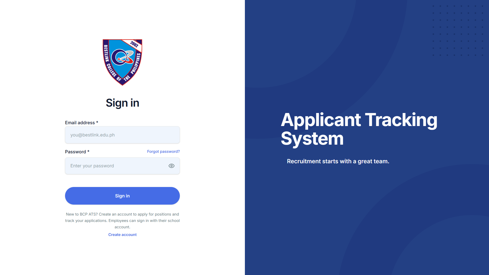
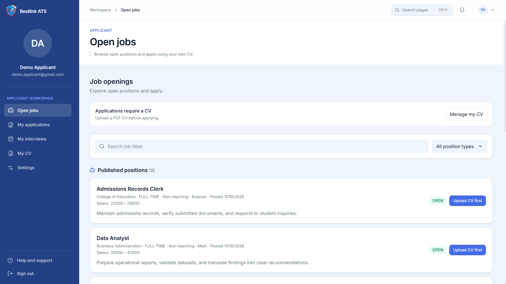
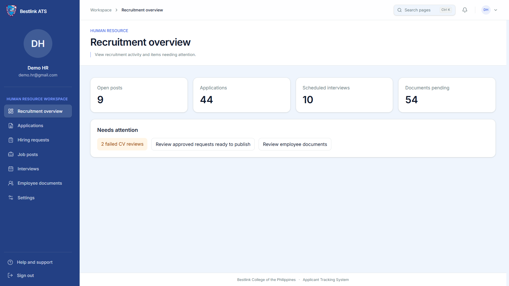
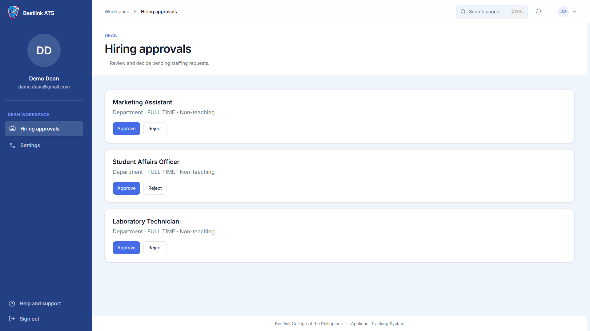
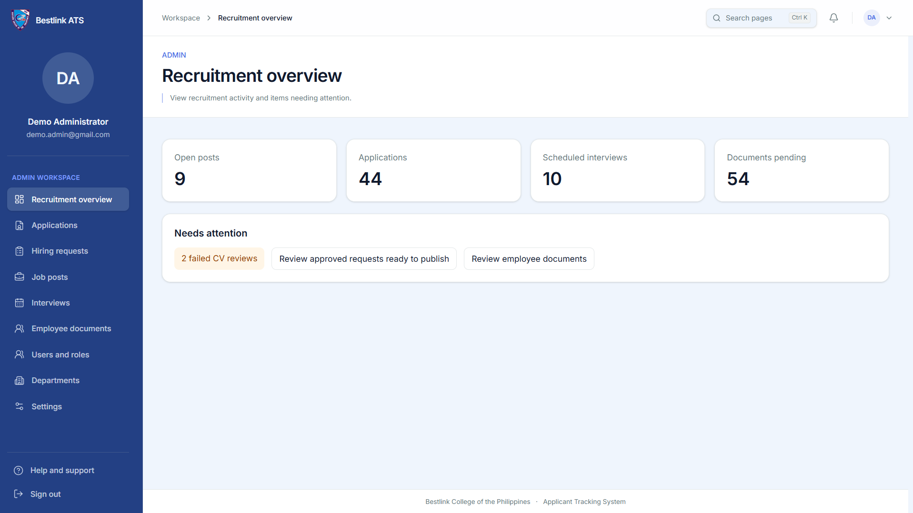
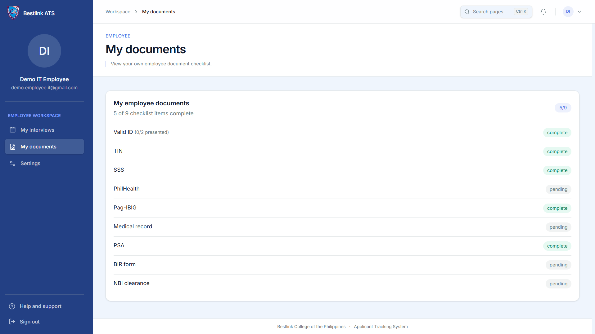

# Applicant Tracking System

The **Applicant Tracking System (ATS)** for Bestlink College of the Philippines is a centralized recruitment platform for teaching and non-teaching positions. It brings staffing requests, approvals, job postings, applications, interviews, hiring decisions, and employee records into one role-based workflow.

The system is designed to replace scattered records and manual handoffs with a shared view of the recruitment process. Applicants can find and apply for open positions, while authorized staff can manage each step from identifying a staffing need through onboarding a new hire.

## What the system does

- Coordinates staffing requests from Department Heads and approval by the Dean.
- Lets HR manage approved hiring requests and publish job openings.
- Gives applicants a place to register, browse openings, submit a PDF CV, apply, and track application progress.
- Organizes application review, advisory CV screening, interviews, and interview evaluations.
- Supports hiring decisions and the transition from applicant to employee record.
- Helps HR maintain employee records and document checklists.
- Provides role-specific workspaces for applicants, HR, Department Heads, the Dean, employees, and administrators.
- Lets users update their account information and change their password.

CV screening is an initial aid for reviewing applications. It does not make the final hiring decision; authorized personnel remain responsible for candidate selection.

## Recruitment workflow

```text
Department Head submits staffing request
                 ↓
          Dean reviews request
                 ↓
       HR manages approved request
                 ↓
          HR publishes job post
                 ↓
 Applicant submits application and CV
                 ↓
       Application and CV review
                 ↓
   Interview scheduling and evaluation
                 ↓
          Hiring decision
                 ↓
 Employee record and department assignment
```

## Who uses it

| Role | What they can do |
| --- | --- |
| **Applicant** | Create and verify an account, browse open positions, manage a CV, apply for jobs, track application status, and view interviews. |
| **Human Resources (HR)** | View recruitment activity, manage hiring requests and job posts, review applications, manage interviews, and maintain employee records and document checklists. |
| **Department Head** | Submit and track department staffing requests, review applicants, and complete assigned interview evaluations. |
| **Dean** | Review, approve, or reject pending staffing requests. |
| **Employee** | View assigned interviews and a personal employee document checklist. |
| **Administrator** | Manage users, roles, and departments. |

Access to pages and actions depends on the signed-in user's role.

## Demo

Explore role-based workflows with seeded sample data. See the [demo setup guide](docs/setup/README.md#seed-demo-data) for account details and instructions.

## Screenshots

The sign-in screen and example role workspaces are shown below. The [page guide](docs/pages/README.md) includes screenshots of individual pages.

### Sign in

<p align="center">
  
</p>

### Role workspaces

<p align="center"><strong>Applicant</strong> &nbsp; · &nbsp; <strong>Human Resources</strong></p>
<p align="center">
  
  
</p>

<p align="center"><strong>Dean</strong> &nbsp; · &nbsp; <strong>Administrator</strong></p>
<p align="center">
  
  
</p>

<p align="center"><strong>Employee</strong></p>
<p align="center">
  
</p>

## Project background

Recruitment involves multiple people and stages. When applicant information and hiring decisions are kept in separate tools or manual records, it becomes harder to find information, track progress, coordinate reviews, and reuse details when a candidate is hired. This project provides a shared system to make those activities easier to follow.

The project was developed as a requirement for **Software Development (Project-Based Elective 3)** in the Computer Engineering program at the **College of Computer Studies, Bestlink College of the Philippines**, under **Engr. Patricia Praxedes A. Gloria**.

## Documentation

| Guide | What it covers |
| --- | --- |
| [Documentation home](docs/README.md) | Navigation to all project guides |
| [Setup and development](docs/setup/README.md) | Local development, Docker, environment variables, and deployment notes |
| [Features and roles](docs/features/README.md) | Detailed goals, workflow, and role capabilities |
| [Pages and screenshots](docs/pages/README.md) | Page-by-page guide, routes, access, and screenshot locations |
| [Architecture](docs/architecture/README.md) | Technology, workspace layout, and design notes |
| [Project information](docs/project/README.md) | Academic scope, project documentation, team, and future work |

## Run locally

For the full instructions, see [Setup and development](docs/setup/README.md). In brief:

```sh
pnpm install
pnpm dev
```

The API also needs its configured PostgreSQL, Redis, and integration services. Alternatively, use the Docker Compose development stack described in the [setup guide](docs/setup/README.md).
