# Page Guide

[Back to documentation](../README.md) · [Repository home](../../README.md)

Browse the screenshots below to see the current application views. Authenticated workspace pages require a signed-in user with the listed role. See the [screenshot folder](../screenshots/README.md) for the uploaded image list.

## Public and account pages

| Page | Route | What the view contains | Screenshot |
| --- | --- | --- | --- |
| Sign in | `/login` | Email and password sign-in, password visibility toggle, and account links. | `sign-in.png` |
| Create account | `/register` | Applicant registration form. | `sign-up.png` |
| Email verification | Registration step | Enter the verification code sent to the applicant. | `verify-email-page.png` |
| Forgot password | `/forgot-password` | Request a reset code and set a new password. | Not captured |

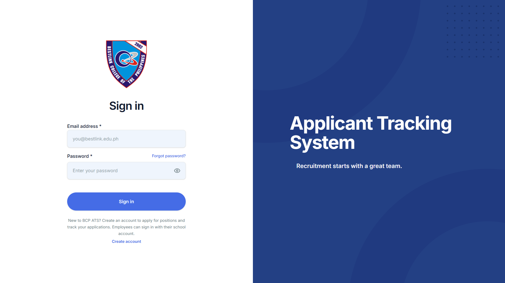

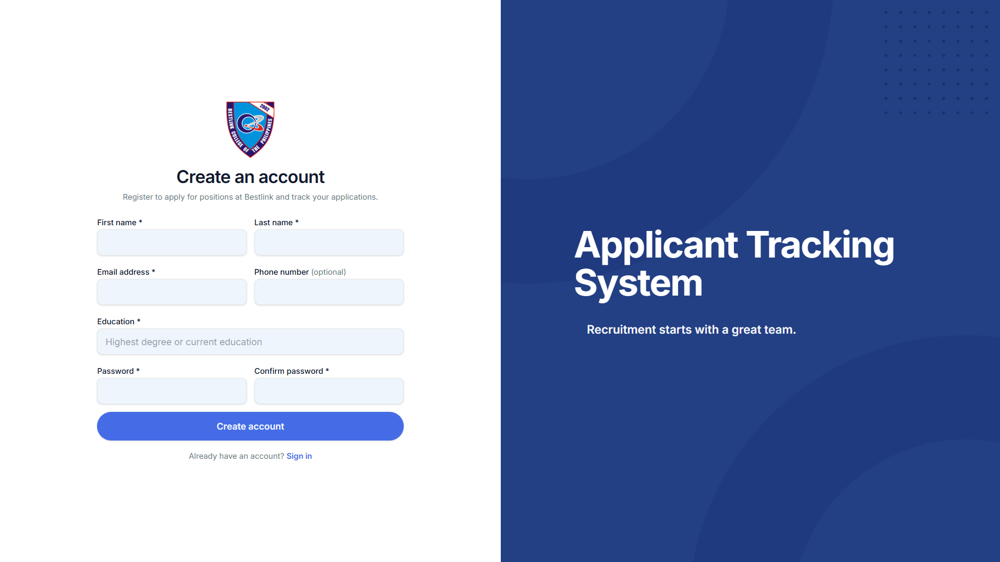

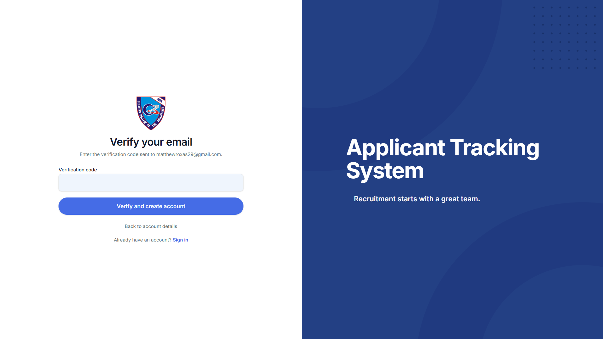

## Applicant pages

| Page | Route | What the view contains | Screenshot |
| --- | --- | --- | --- |
| Open jobs | `/a/jobs` | Browse, search, and filter open positions; apply after uploading a CV. | `applicant-open-jobs-page.png` |
| My applications | `/a/applications` | View submitted applications, progress, and CV review status. | `applicant-my-application-page.png` |
| My interviews | `/a/interviews` | View the applicant's interview schedule and details. | `applicant-my-interview-page.png` |
| My CV | `/a/cv` | Upload, replace, or download a PDF CV (up to 5 MB). | `applicant-cv-upload-page.png` |

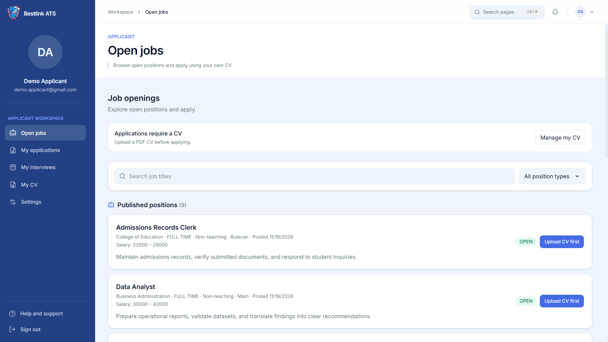

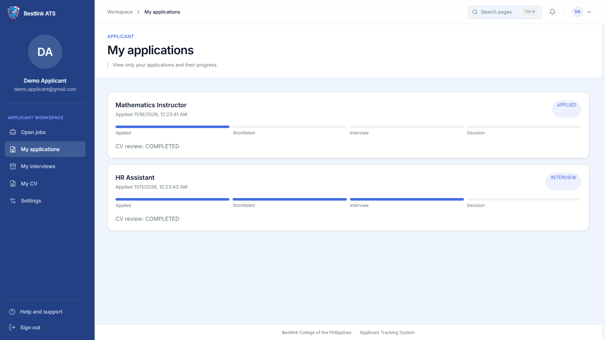

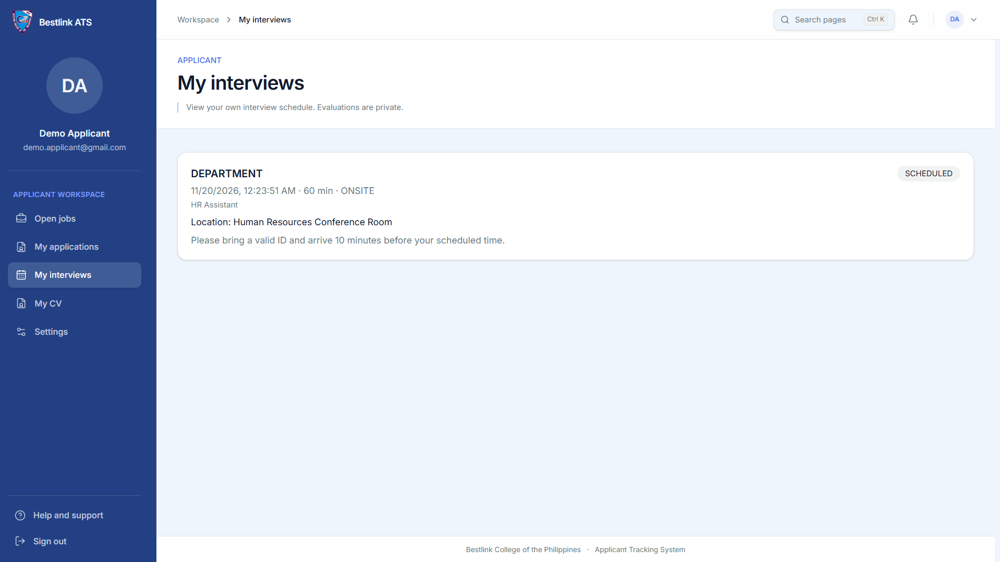

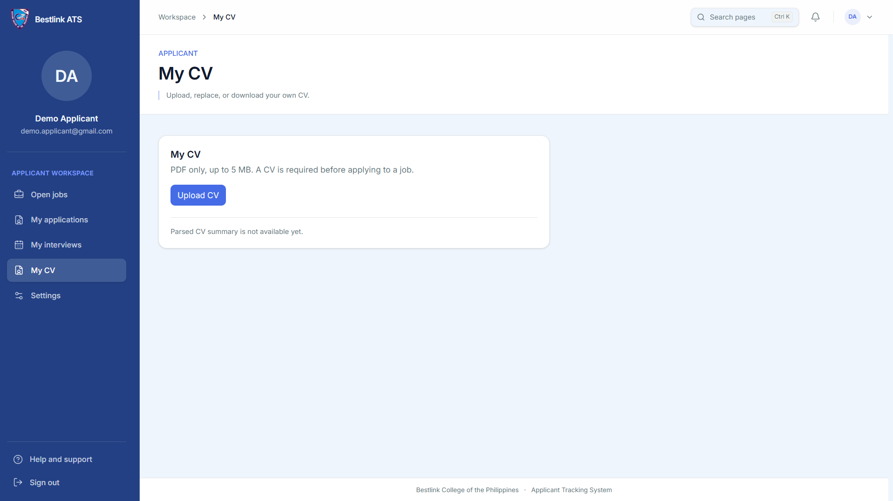

## HR pages

| Page | Route | What the view contains | Screenshot |
| --- | --- | --- | --- |
| Recruitment overview | `/h/dashboard` | Recruitment summary and items needing attention. | `recruitment-overview-page.png` |
| Applications | `/h/applications` | Search and review applications, screening results, and candidate status. | `recruitment-application-page.png` |
| Hiring requests | `/h/job-posts` | Review requests and their approval status. | `recruitment-hiring-request-page.png` |
| Published job posts | `/h/job-posts/published` | Browse and manage published job openings. | `recruitment-job-post-page.png` |
| Interviews | `/h/interviews` | Schedule interviews and manage evaluations. | `recruitment-interview-page.png` |
| Employee documents | `/h/employees` | Browse employee records and their document checklists. | `recruitment-employee-document-page.png` |

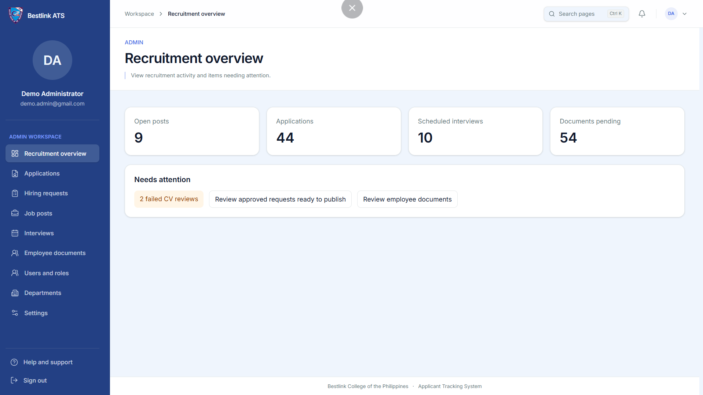

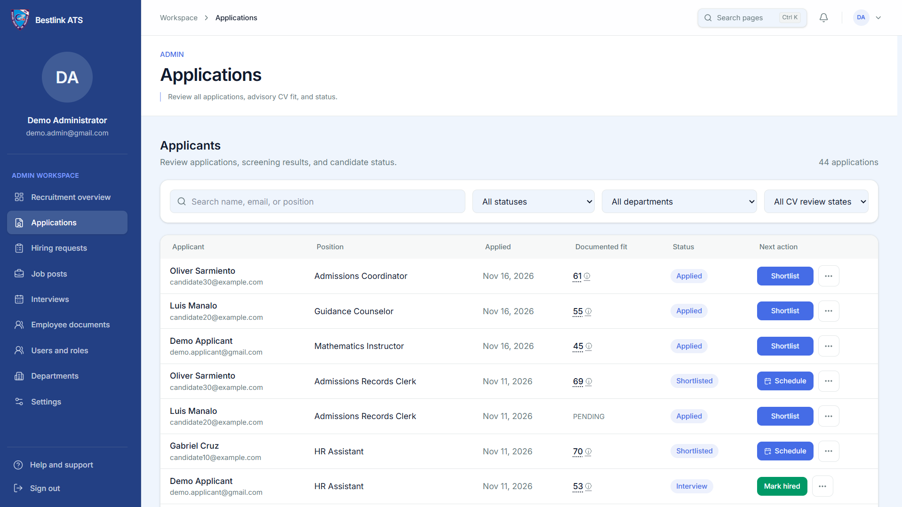

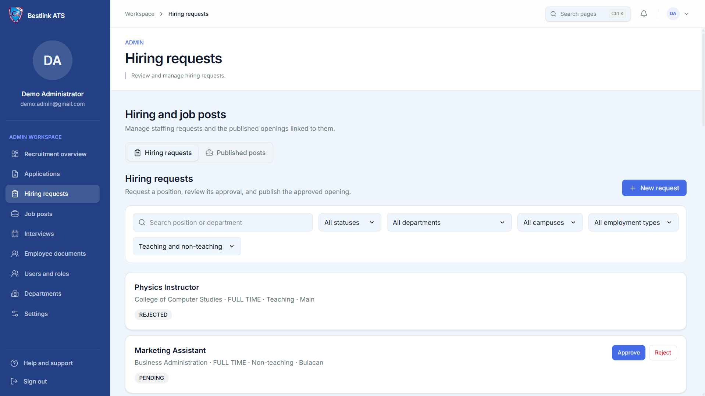

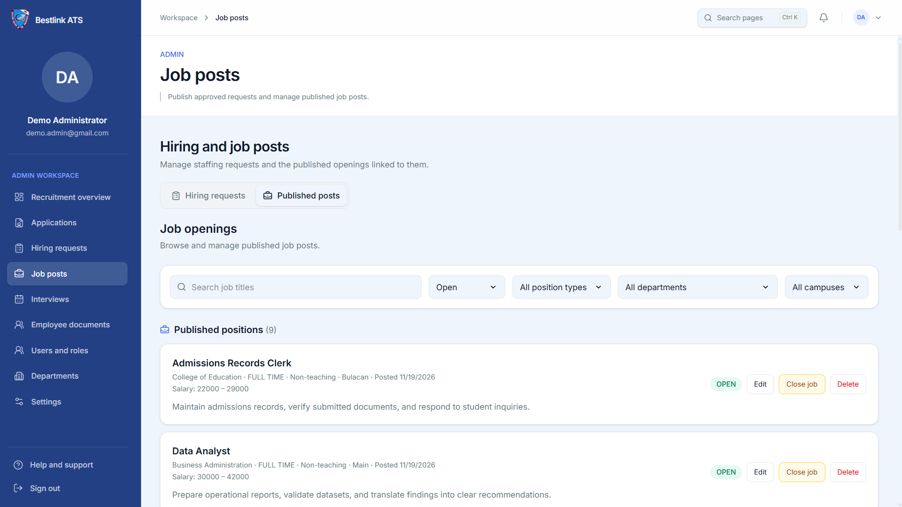

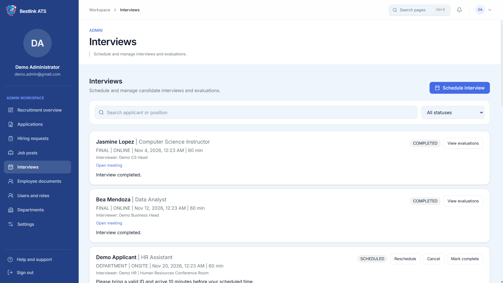

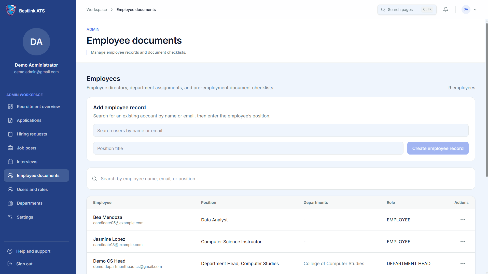

## Department Head pages

| Page | Route | What the view contains | Screenshot |
| --- | --- | --- | --- |
| Staffing requests | `/d/requests` | Submit and track requests for the Department Head's department. | Not captured |
| Request details | `/d/requests/:id` | View details for a selected staffing request. | Not captured |
| Interview evaluations | `/d/evaluations` | Review assigned interviews and submit evaluations. | Not captured |

## Dean pages

| Page | Route | What the view contains | Screenshot |
| --- | --- | --- | --- |
| Hiring approvals | `/n/approvals` | Review pending staffing requests and approve or reject them. | `recruitment-hiring-approval-page.png` |

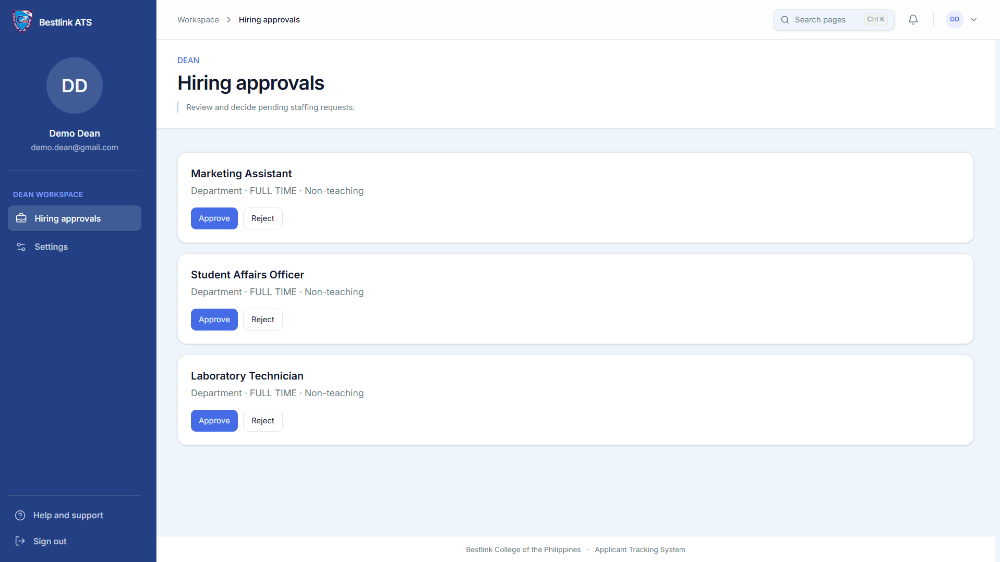

## Administrator pages

| Page | Route | What the view contains | Screenshot |
| --- | --- | --- | --- |
| Users and roles | `/m/users` | Search users and assign account roles. | `recruiitment-user-role-page.png` |
| Departments | `/m/departments` | Manage departments, department heads, and membership. | `recruitment-department-page.png` |

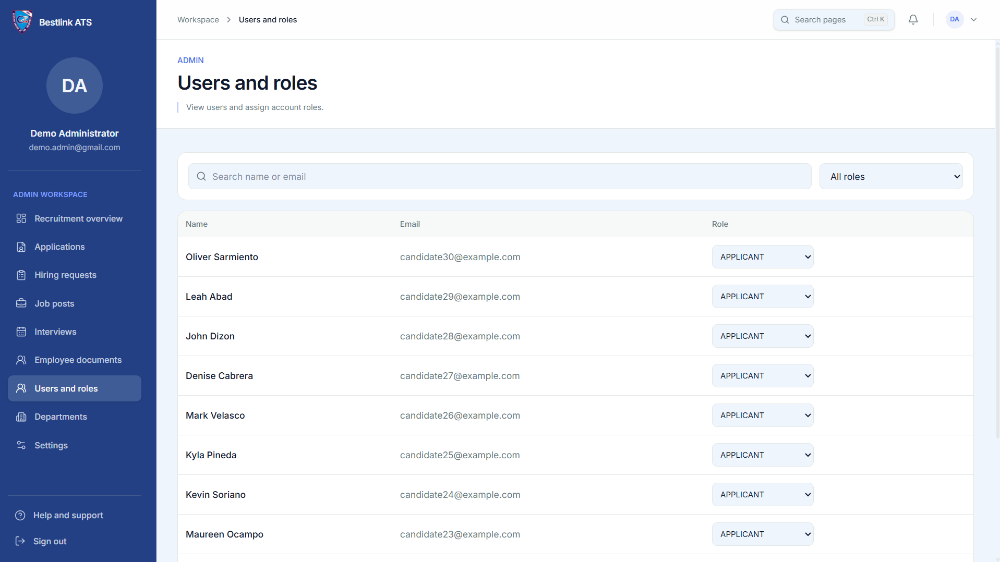

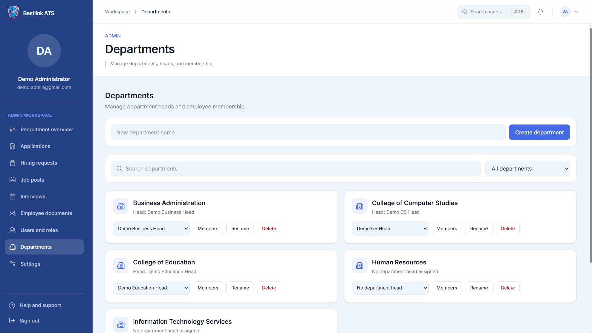

## Employee pages

| Page | Route | What the view contains | Screenshot |
| --- | --- | --- | --- |
| My interviews | `/e/interviews` | View interviews assigned to the employee. | Not captured |
| My documents | `/e/documents` | View the employee's personal document checklist and status. | `employee-my-document-page.png` |

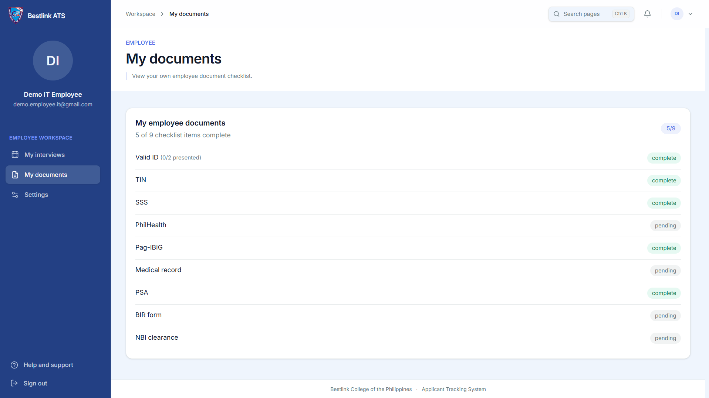

## Shared account page

| Page | Route | What the view contains | Screenshot |
| --- | --- | --- | --- |
| Settings | `/settings` | Update account information and change the password. | `settings-page.png` |

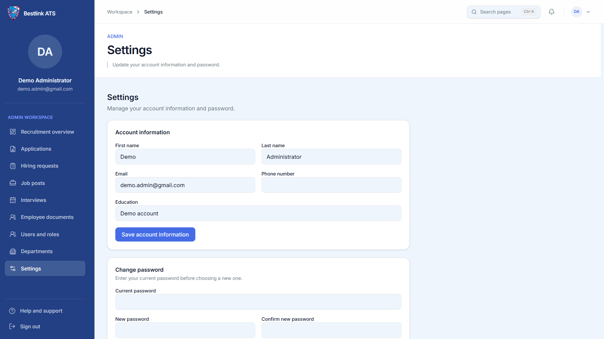

## Route shortcuts

These older routes redirect to role-specific pages; they do not have separate screenshots:

| Shortcut | Destination |
| --- | --- |
| `/jobs` | Applicant jobs or HR job posts |
| `/applicants` | HR applications |
| `/interviews` | Applicant, employee, or HR interviews |
| `/employees` | Employee documents or HR employee records |
| `/team` | HR employee records |
| `/hiring-requests` | Department Head requests, Dean approvals, or HR hiring requests |
| `/departments` | Administrator departments |
