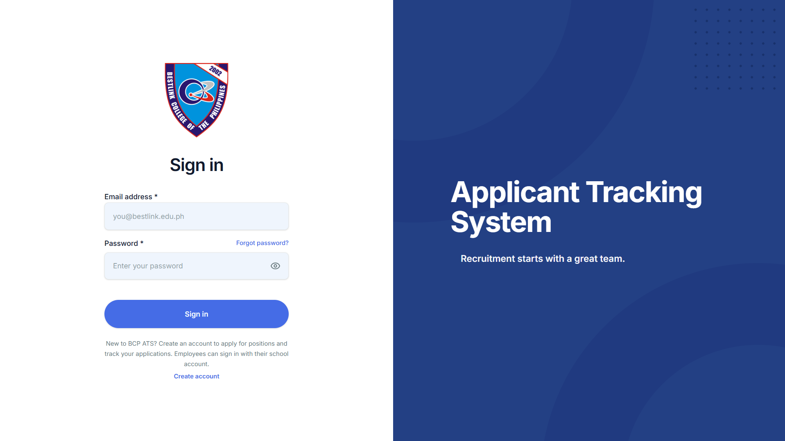

# Screenshot Folder

Add page screenshots here. The [page guide](../pages/README.md) documents the routes and suggested image filenames.

Use PNG files with these names:

- `sign-in.png`, `register.png`, `forgot-password.png`
- `applicant-jobs.png`, `applicant-applications.png`, `applicant-interviews.png`, `applicant-cv.png`
- `hr-overview.png`, `hr-applications.png`, `hr-hiring-requests.png`, `hr-job-posts.png`, `hr-request-details.png`, `hr-interviews.png`, `hr-employees.png`
- `department-head-requests.png`, `department-head-request-details.png`, `department-head-evaluations.png`
- `dean-approvals.png`
- `admin-users.png`, `admin-departments.png`
- `employee-interviews.png`, `employee-documents.png`
- `settings.png`

Add a Markdown image line below the related table in `docs/pages/README.md` to display an image on GitHub. For example:

```md

```

Avoid including real applicant, employee, or account information in screenshots. Use test data or obscure personal information before committing images.
